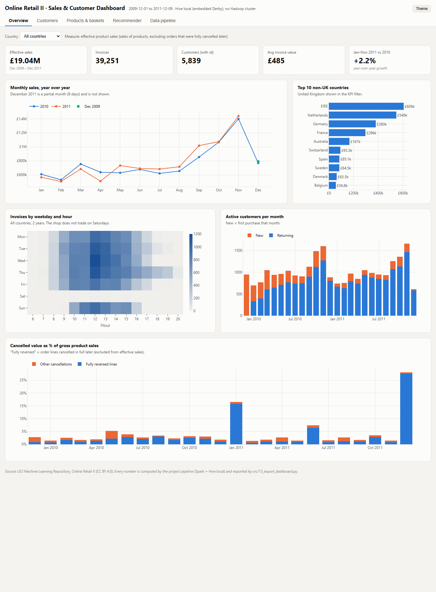
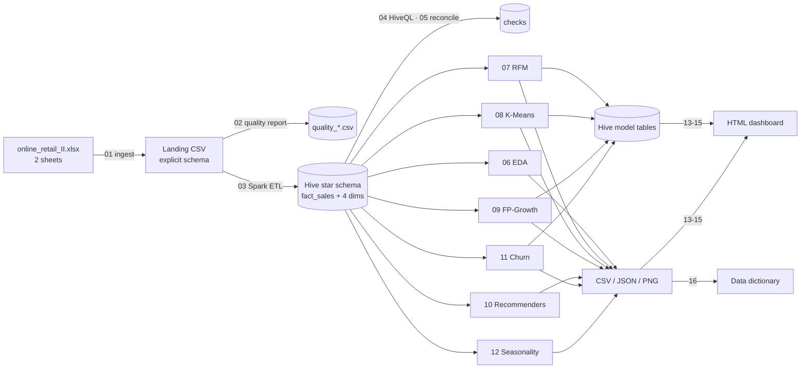
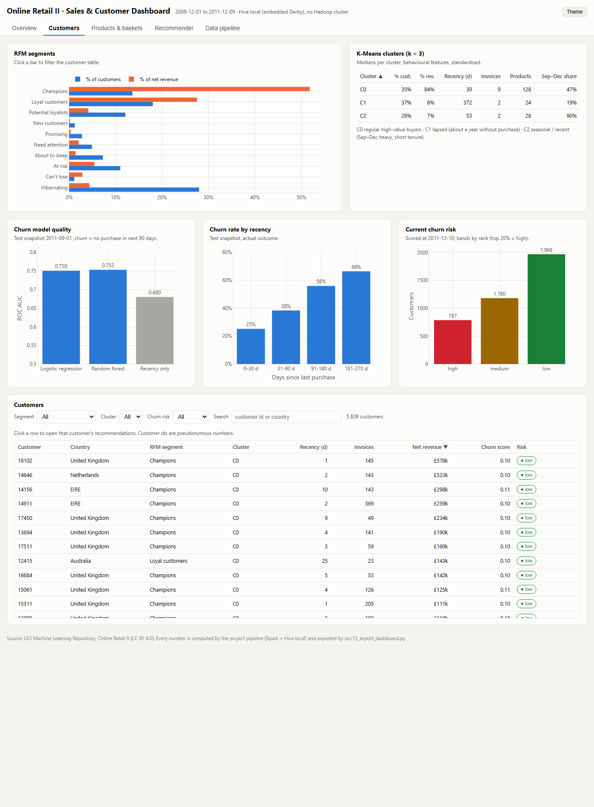
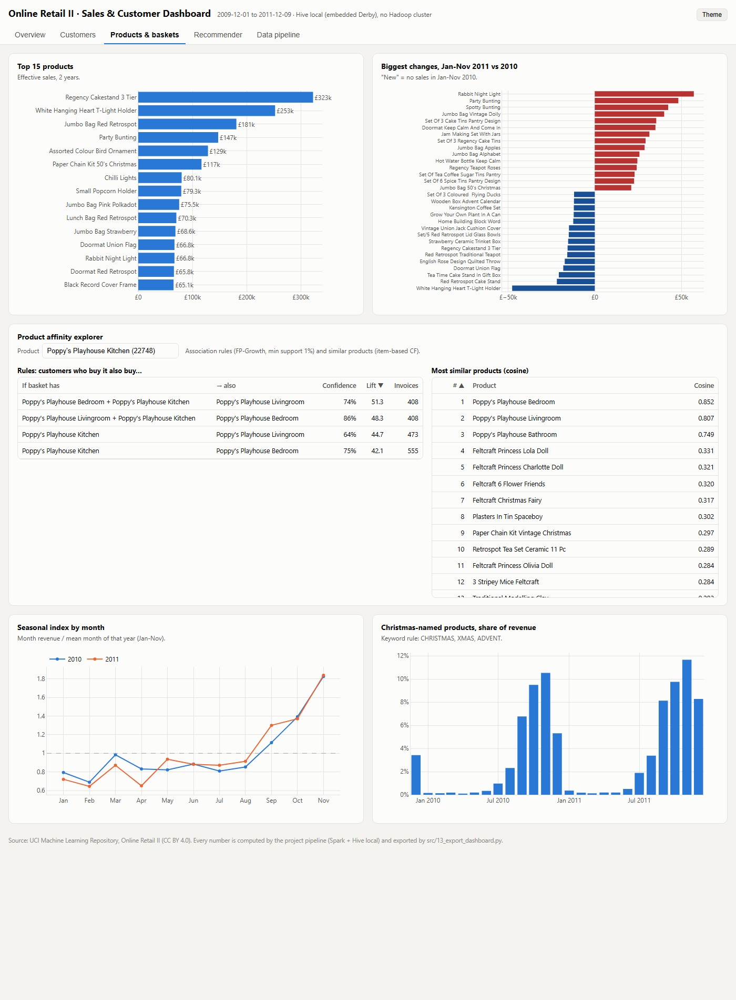
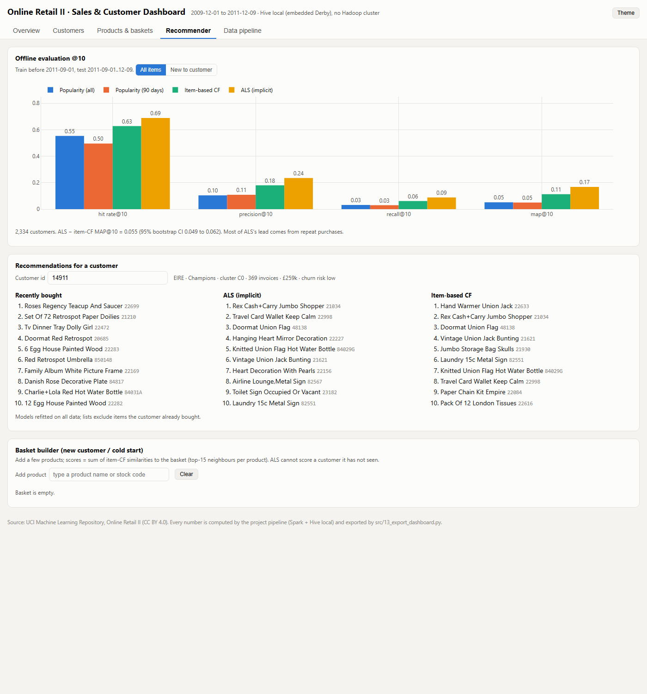

# Online Retail II — Customer Analytics & Recommendation Pipeline

**Spark · Hive · Spark MLlib · Python** — an end-to-end, reproducible big-data pipeline that turns
two years of raw e-commerce transactions into customer segments, product affinities,
personalised recommendations, churn risk scores and an interactive dashboard.



## What this project answers

| Business question | How | Where to look |
|---|---|---|
| Which products are bought together? | FP-Growth association rules on real invoices | `outputs/tables/fpgrowth_rules.csv`, dashboard › *Products & baskets* |
| Can we group customers by behaviour? | RFM scoring + K-Means clustering (Spark MLlib) | `rfm_segment_summary.csv`, `kmeans_cluster_profile.csv` |
| Who are the most valuable customers? | RFM segments, revenue concentration | dashboard › *Customers* |
| What should we recommend, also to a new customer? | ALS (implicit) and item-based CF vs popularity, temporal evaluation, cold start | `rec_metrics.csv`, dashboard › *Recommender* |
| Is there seasonality? Who is likely to churn? | Year-over-year seasonal index; churn model on a same-season split | `seasonality_*.csv`, `churn_metrics.csv` |

## Quick start

```bash
# 1. clone and install (Python 3.12, Java 8/11/17 on the PATH)
git clone <this-repo-url> online-retail-pipeline
cd online-retail-pipeline
pip install -r requirements.txt

# 2. get the data (not committed): save the UCI workbook as data/online_retail_II.xlsx
#    https://archive.ics.uci.edu/dataset/502/online+retail+ii

# 3. Windows only: put winutils.exe and hadoop.dll (Hadoop 3.3.x build) in tools/hadoop/bin/

# 4. run everything (steps 00-16)
python run_pipeline.py

# 5. open the dashboard
start outputs/dashboard/retail_dashboard.html      # macOS: open …   Linux: xdg-open …
```

Run part of the pipeline with `python run_pipeline.py --from 06 --to 12`, or a single step with
`python src/09_fpgrowth.py`. Every step reads the Hive tables written by the earlier steps, so
steps 00-05 must have run once before any later step.

**Measured runtime** of a full run on the development laptop (Windows 11, i5-1035G1, 8 GB RAM; workbook already converted): **48 minutes** in total. The slowest steps are the recommender tuning (10), FP-Growth with its support-sensitivity runs (09) and the K-Means stability scan (08). Timings of the last run are written to `outputs/pipeline_run_log.csv`.

| Step | 00 | 01 | 02 | 03 | 04 | 05 | 06 | 07 | 08 | 09 | 10 | 11 | 12 | 13 | 14 | 15 | 16 |
|---|---|---|---|---|---|---|---|---|---|---|---|---|---|---|---|---|---|
| Time | 45 s | 28 s | 55 s | 2.2 min | 56 s | 60 s | 1.2 min | 50 s | 5.4 min | 8.6 min | 18.6 min | 2.0 min | 59 s | 3.6 min | 1 s | 20 s | 41 s |

<details>
<summary><b>Setup details and troubleshooting</b></summary>

- **Java**: PySpark 3.5 runs on Java 8, 11 or 17 (PySpark 4.x would need Java 17+). `java -version` must work in the same shell.
- **Windows**: Spark's Hive support needs the Hadoop native helpers `winutils.exe` and `hadoop.dll`. A commonly used community build is `github.com/cdarlint/winutils` (folder `hadoop-3.3.6/bin`; not an official Apache release). Place both files in `tools/hadoop/bin/`; `src/common.py` sets `HADOOP_HOME` automatically. This is **not** a Hadoop installation. Linux and macOS do not need it.
- **Memory**: Spark runs with a 2 GB driver (`SPARK_DRIVER_MEMORY` in `src/common.py`). On an 8 GB laptop, close browsers and other heavy apps while the pipeline runs.
- **First run**: step 01 converts the Excel workbook to CSV once (the slow part of ingestion); later runs reuse the CSV while the workbook's MD5 is unchanged.
- **Harmless message**: when Hive creates a new database it may print the `hadoop fs -chmod` usage text if the project path contains a space. The step still exits with code 0.
- **pandas 3 + PySpark 3.5**: on the development machine `toPandas()`, `createDataFrame(pandas_df)` and Python UDFs crashed the Python worker, so the code never uses them (`common.to_pandas` collects small results; probabilities use `vector_to_array`).
</details>

## Pipeline



| Step | Script | What it does |
|---|---|---|
| 00 | `00_check_env.py` | Records tool versions; creates, reads and drops a Hive table |
| 01 | `01_ingest.py` | Converts both Excel sheets to a landing CSV; Spark reads it with an explicit schema (FAILFAST) |
| 02 | `02_quality.py` | Raw-data quality report: nulls, duplicates, sheet overlap, invoice types, invalid values, codes, coverage |
| 03 | `03_etl_hive.py` | Cleans and flags the data, computes revenue, matches fully cancelled orders, loads the Hive star schema |
| 04 | `04_hive_queries.py` | HiveQL queries that prove the tables work |
| 05 | `05_reconcile.py` | Re-implements the cleaning rules in pandas and stops the pipeline if any metric differs from Spark/Hive |
| 06 | `06_eda.py` | Trends, year-over-year, weekday/hour, countries, products, customers, invoices, cancellations |
| 07 | `07_rfm_customer.py` | Customer RFM scores and segments → `retail.customer_rfm` |
| 08 | `08_kmeans_customers.py` | K-Means with silhouette, elbow and seed-stability selection → `retail.customer_clusters` |
| 09 | `09_fpgrowth.py` | FP-Growth with a support-sensitivity run → `retail.assoc_rules` |
| 10 | `10_recommender.py` | Popularity vs item-based CF vs ALS: temporal split, tuning, bootstrap, cold start |
| 11 | `11_churn.py` | Churn model (logistic regression, random forest, recency baseline) → `retail.customer_churn_risk` |
| 12 | `12_seasonality.py` | Seasonal index, weekly year-over-year, Christmas share, product growth and decline |
| 13 | `13_export_dashboard.py` | Refits the recommenders on all data and exports the dashboard data → `retail.customer_recommendations` |
| 14 | `14_build_dashboard.py` | Builds the single-file HTML dashboard (plotly.js inlined, works offline) |
| 15 | `15_screenshot_dashboard.py` | Saves a screenshot of each dashboard tab (headless Edge/Chrome) |
| 16 | `16_data_dictionary.py` | Writes `outputs/data_dictionary.md`; fails if any output is undocumented |

## Data

[Online Retail II](https://archive.ics.uci.edu/dataset/502/online+retail+ii) (UCI Machine Learning
Repository, CC BY 4.0): invoice lines of a UK online giftware retailer, many of whose customers are
wholesalers, from December 2009 to December 2011. Columns: `Invoice, StockCode, Description,
Quantity, InvoiceDate, Price, Customer ID, Country`.

**Cleaning rules** (details in `src/03_etl_hive.py`):
1. The two sheets overlap on 2010-12-01..09 with identical rows; the copy in the first sheet is dropped.
2. Rows identical in all eight source columns are treated as double-recorded and dropped.
3. Nothing else is deleted; rows are flagged: `txn_type` (sale / cancellation `C…` / adjustment),
   `is_product` (false for postage, fees, discounts, vouchers, tests), `has_customer`, and
   `is_reversed` (a sale line fully cancelled later, together with its cancellation).
4. **Effective product sales** = `txn_type = 'sale' AND is_product AND NOT is_reversed` is the
   measure used by all analytics. Lines without a customer id count for revenue but not for
   customer models.

**Hive star schema** (database `retail`): `fact_sales` (partitioned by month) with `dim_product`,
`dim_customer`, `dim_date`, `dim_country`; model outputs are written back as
`customer_rfm`, `customer_clusters`, `assoc_rules`, `customer_churn_risk`,
`customer_recommendations`. All columns are described in
[`outputs/data_dictionary.md`](outputs/data_dictionary.md).

## Methods

- **RFM** — reference date = day after the last invoice; recency, frequency (invoices) and net monetary value scored 1-5 by percentile rank (ties share a score); ten segments from the standard recency × frequency grid.
- **K-Means** — six log-transformed, standardised behavioural features (recency, frequency, average invoice, assortment breadth, tenure, peak-season share). k is chosen by a rule set before running: silhouette within 0.01 of the best, then the highest stability across five seeds (adjusted Rand index); the final model is the best of five starts.
- **FP-Growth** — one transaction per invoice; minimum support 1 % and confidence 20 %, chosen after a support-sensitivity run; rules between similarly named products (same collection or design) are flagged.
- **Recommenders** — popularity (all time and last 90 days), item-based collaborative filtering (cosine) and ALS with implicit feedback. Trained before 2011-09-01 and tested on the following months; ALS tuned on an earlier split inside the training period; hit rate, precision, recall and MAP @5/10/20 for all items and for items new to the customer; paired bootstrap confidence intervals; separate cold-start evaluation.
- **Churn** — churn = no purchase in the 90 days after a snapshot, features from the 270 days before it; trained at 2010-09-01 and tested at 2011-09-01 (same season); compared with a recency-only baseline.
- **Seasonality** — monthly seasonal index and weekly sales for 2010 vs 2011, Christmas-product share, product growth and decline.

## Results and dashboard

All results are written by the pipeline to `outputs/tables/` (CSV/JSON) and `outputs/figures/`
(PNG, 200 dpi). The dashboard `outputs/dashboard/retail_dashboard.html` has five tabs; open one
directly with `#customers`, `#products`, `#recommender` or `#pipeline`.

| Customers | Products & baskets | Recommender |
|---|---|---|
|  |  |  |

## Project structure

```
├── run_pipeline.py              # runs steps 00-16 in order, stops at the first failure
├── requirements.txt
├── src/
│   ├── common.py                # paths, schema, cleaning constants, SparkSession (Hive local)
│   ├── plotstyle.py             # shared chart style
│   ├── dashboard_template.html  # dashboard source (HTML/CSS/JS)
│   └── 00_…py … 16_…py          # one script per step
├── data/                        # put online_retail_II.xlsx here (not committed)
├── outputs/
│   ├── tables/                  # result tables
│   ├── figures/                 # charts and dashboard screenshots
│   ├── dashboard/               # retail_dashboard.html
│   └── data_dictionary.md
└── scripts/hdfs_put.sh          # optional: copy the landing CSV to HDFS on a real cluster
```

Generated at run time and not committed: `data/landing/`, `warehouse/` (Hive data),
`metastore/` (Hive metastore), and per-customer output tables.

## Tech stack

| | Version |
|---|---|
| Python | 3.12 |
| Java | 1.8 (8/11/17 supported) |
| Apache Spark (PySpark) | 3.5.3 — local mode, Hive support, Spark SQL, MLlib |
| pandas · numpy · scipy · scikit-learn | 3.0.2 · 2.2.6 · 1.17.1 · 1.9.1 |
| matplotlib · plotly.js | 3.11.2 · 2.35.2 |

Exact versions of the last run are stored in `outputs/tables/environment.json`.

## Scope and limitations

- **Execution environment**: Spark runs in local mode on one machine; Hive is Spark's built-in Hive support with an embedded Derby metastore and a local warehouse. No Hadoop cluster, HDFS, YARN or MapReduce was used. `scripts/hdfs_put.sh` shows the HDFS step for a cluster but was not run.
- **Dashboard**: plain HTML/JavaScript reading exported data, not a live connection to Hive.
- **Data**: customer models only cover lines with a customer id; two years give two seasonal cycles (enough to see the Q4 peak repeat, not to separate trend from seasonality); duplicate, overlap and reversed-order handling are documented assumptions; no cost data, so revenue rather than profit; one retailer with many wholesale customers.
- **Models**: recommenders are evaluated offline on one temporal split that falls in the Christmas peak; churn probabilities are ranked rather than read as calibrated probabilities when scoring a different season.
- **Reproducibility**: fixed seed (`SEED = 42`); step 05 checks Spark against an independent pandas implementation; step 16 checks that every output is documented.

## Acknowledgements

Data: *Online Retail II*, UCI Machine Learning Repository, licensed under CC BY 4.0.
